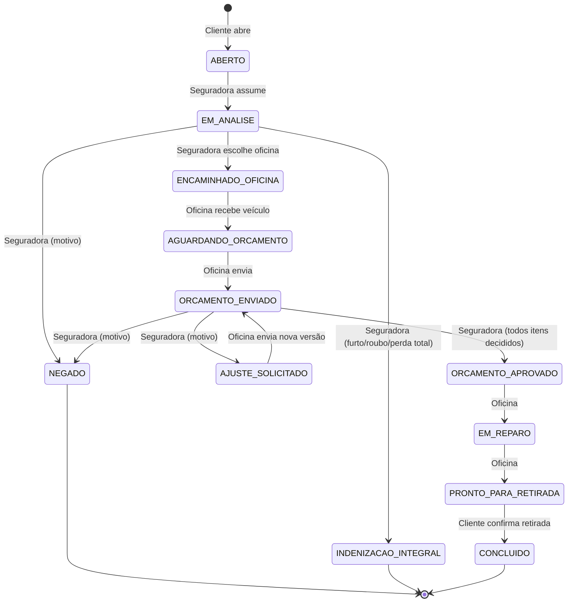

# SafetyCare — MVP

Plataforma de acompanhamento de sinistro de veículo (carro e moto), da abertura até a entrega do veículo consertado.

Três perfis atuam no **mesmo sinistro**, cada um com sua visão:

| Perfil | Rota | O que faz |
| --- | --- | --- |
| **Cliente** (segurado) | `/app` | Cadastra veículos e apólice, abre o sinistro marcando os danos no modelo 3D, acompanha tudo e confirma a retirada. |
| **Seguradora** (analista) | `/seguradora` | Assume a análise, nega, encaminha a uma oficina ou indeniza integralmente; revisa o orçamento item a item (coberto / não coberto) e aprova ou pede ajuste. |
| **Oficina** | `/oficina` | Confirma o recebimento do veículo, monta o orçamento clicando nas peças do 3D, inicia o reparo e avisa quando está pronto. |

O diferencial é o **visualizador 3D**: cada peça é um mesh separado. Ao passar o mouse (ou tocar) sobre ela, a peça se destaca e mostra nome, ação (trocar/reparar/pintar), valores e cobertura. As cores indicam a ação; itens não cobertos aparecem hachurados com contorno vermelho.

## Stack

Next.js 15 (App Router) · TypeScript strict · Tailwind CSS 4 + shadcn/ui · Prisma + PostgreSQL · Auth.js (credentials + bcrypt) · three.js com @react-three/fiber e drei · Zod · Server Actions · Vitest.

## Como rodar

Pré-requisitos: Node 20+ e Docker.

```bash
cp .env.example .env              # ajuste AUTH_SECRET (openssl rand -base64 32)
npm install
docker compose up -d              # Postgres em localhost:5434
npx prisma migrate dev            # aplica as migrações
npm run db:seed                   # dados de exemplo
npm run dev                       # http://localhost:3000
```

Outros comandos:

```bash
npm run check        # typecheck + lint + testes
npm test             # Vitest (máquina de estados, permissões, regras de orçamento)
npm run db:reset     # recria o banco e roda o seed
```

O visualizador 3D isolado fica em **`/lab/3d`** (público), com carro e moto nos modos `select` e `view`.

## Logins de teste

Senha de todos: **`safety123`**

| Perfil | E-mail | Observação |
| --- | --- | --- |
| Seguradora | `seguradora@safetycare.test` | Carla Mendes (analista) |
| Oficina | `oficina1@safetycare.test` | Auto Center Prime |
| Oficina | `oficina2@safetycare.test` | MotoFix Oficina |
| Cliente | `ana@safetycare.test` | Onix (carro) e CG 160 (moto) |
| Cliente | `bruno@safetycare.test` | HB20 (carro) |

Sinistros do seed:

| Protocolo | Cliente | Status | Destaque |
| --- | --- | --- | --- |
| SC-2026-000001 | Ana | Aberto | Para a seguradora assumir |
| SC-2026-000002 | Ana (moto) | Encaminhado à oficina | Para a MotoFix confirmar recebimento |
| SC-2026-000003 | Bruno | Orçamento enviado | Para a seguradora revisar item a item |
| SC-2026-000004 | Ana | Pronto para retirada | Orçamento **parcialmente coberto** (v1 com ajuste, v2 aprovada) |
| SC-2026-000005 | Bruno | Negado | Sem cobertura de vidros |

### Roteiro de demonstração

1. Entre como **ana** → *Abrir sinistro* → escolha o Onix → relato → clique nas peças danificadas no 3D → revise e envie.
2. Entre como **seguradora** → abra o novo sinistro → *Assumir análise* → escolha a oficina → *Encaminhar*.
3. Entre como **oficina1** → *Confirmar recebimento* → clique nas peças no 3D para criar itens, preencha valores e prazo → *Enviar*.
4. Volte como **seguradora** → marque cada item como coberto ou não coberto (o 3D e a prévia financeira atualizam ao vivo) → *Aprovar*.
5. Volte como **ana** → veja o carro colorido por peça e o card *Quanto você vai pagar*.

## Máquina de estados do sinistro

Implementada como função pura em [`src/domain/claim-state-machine.ts`](src/domain/claim-state-machine.ts). A tabela de transições define **qual perfil** pode executar cada transição. Toda mudança de status passa por `applyTransition` ([`src/server/claims.ts`](src/server/claims.ts)). Essa função valida a transição, aplica a mudança com checagem otimista do status anterior e grava um `ClaimEvent` na mesma transação.



### Resumo financeiro

Calculado em [`src/domain/quote.ts`](src/domain/quote.ts). Valores em centavos.

- **Coberto**: soma dos itens marcados como `COBERTO`.
- **Franquia aplicada**: `min(franquia da apólice, total coberto)`.
- **Seguradora paga**: `coberto − franquia aplicada`.
- **Você paga**: `franquia aplicada + itens não cobertos`.

## Arquitetura

```
src/
  domain/            regras puras (sem I/O), todas testadas
    claim-state-machine.ts   transições + perfis + pré-condições
    permissions.ts           quem vê/edita o quê (claimScope usado em toda consulta)
    quote.ts                 totais, sugestão de ação, resumo financeiro
    parts.ts                 catálogo de peças (partKey, rótulo pt-BR, tipos de veículo)
  server/            serviços com Prisma (checam permissão em toda query/mutação)
    claims.ts  quotes.ts  vehicles.ts  storage.ts (StorageService local)
  actions/           Server Actions finas: sessão + Zod + serviço + revalidação
  components/
    vehicle-3d/      VehicleViewer, VehicleModelProvider, provider procedural
    claim/           stepper, linha do tempo, mensagens, anexos, tabela, resumo
  app/               rotas por perfil (/app, /oficina, /seguradora), /lab/3d
```

- **Acesso**: o middleware barra por prefixo de rota. Cada página e cada Server Action também checa a sessão e o perfil. As consultas usam `claimScope(actor)`: o cliente vê só os próprios sinistros, a oficina só os encaminhados a ela e a seguradora vê todos.
- **3D**: `VehicleModelProvider.getModel(type)` devolve os meshes por `partKey`. O provider procedural (primitivas arredondadas, sem assets externos) é a primeira implementação. Um provider GLB pode carregar o arquivo e mapear `node.name → partKey` sem mudar o `VehicleViewer`. A cena carrega com `dynamic(..., { ssr: false })` e mostra um skeleton enquanto isso. A lista lateral fica sincronizada com o modelo nos dois sentidos e serve de alternativa por teclado e de fallback para toque.
- **Datas**: gravadas em UTC e exibidas em `America/Sao_Paulo`, pt-BR.
- **Uploads**: ficam em `public/uploads/<claimId>/` atrás da interface `StorageService`. No MVP, o arquivo é público para quem tiver a URL (nome aleatório). Para produção, troque por storage privado com URL assinada.

## Fora do escopo (pontos de extensão)

Pagamentos, integração real com seguradoras, notificações por e-mail/push, app nativo, chat em tempo real, multi-tenant, upload em nuvem (`StorageService`), IA para detectar dano por foto e modelos GLB reais (`VehicleModelProvider`).
